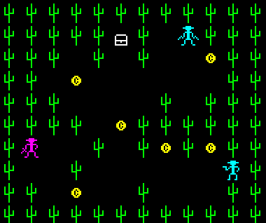

# so_long - Cowboys Revenge

A project from the 42 curriculum. The goal of this project is to create a small 2D game using the MiniLibX library. The player must collect all coins and reach the exit while avoiding enemies in a desert-themed map.

## Overview

This implementation of so_long features a cowboy-themed adventure with additional custom mechanics beyond the mandatory requirements.

### Mandatory Features

- Parse and validate a `.ber` map file
- Render the map using MiniLibX (walls, floor, player, collectibles, exit)
- Player movement with arrow keys
- Collect all coins before the exit becomes accessible
- Basic enemy collision (player dies on contact)
- Clean window closing (ESC / window X)

### Bonus Features

- **Gold Rush System**: The player has a limited number of steps. Collecting a gold coin resets the step counter. Running out of steps results in death.
- **Two Enemy Types**:
  - Horizontal enemy (`X`) – patrols left/right
  - Vertical enemy (`Y`) – patrols up/down
- **Stealth Kills**: Enemies can be defeated by approaching them from behind.
- **Score System**:
  - Collecting a coin: **+500** points
  - Each step taken: **-25** points
  - Killing an enemy: **-250** points
  - Highest score is achieved by finishing with as few steps as possible and without killing any enemies.

## Gameplay



## Compilation and Usage

### 1. Compilation

```bash
make
```

### 2. Usage

```bash
./so_long maps/map.ber
```

Use the **arrow keys** to move and **ESC** to quit.

## Requirements

- Language: C
- Compiler: `cc`
- Flags: `-Wall -Wextra -Werror`
- Library: MiniLibX + libft

## Author

- **joschmun** - *42 Student*
